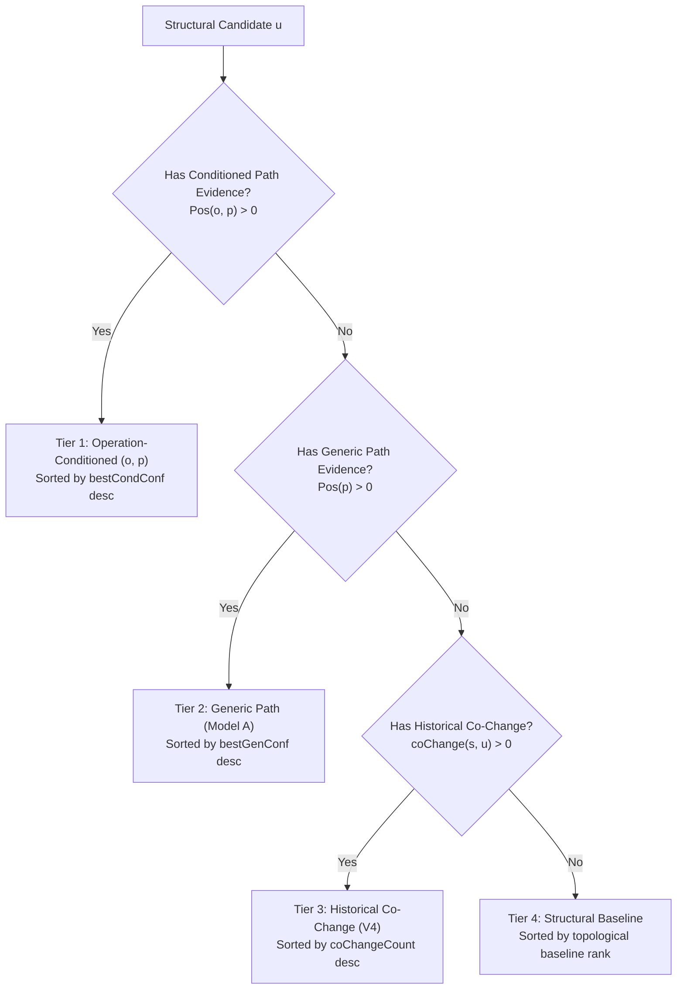

# OCCP Scoring, Fallback & Statistical Design Audit

**Project:** Context-Aware Software Change Impact Analysis Framework  
**Location:** `C:\yashika\STUDY\clg_project\software_change`  
**Date:** 2026-10-20  
**Audit Directory:** `software_change/research_artifacts/full_project_audit_20261020/`  

---

## 1. Algorithmic Pipeline & Technical Specification

The OCCP implementation was audited by tracing code in [`backend/src/services/occp/`](file:///C:/yashika/STUDY/clg_project/software_change/backend/src/services/occp/) and [`backend/src/evaluation/v5/occpEvalHarness.js`](file:///C:/yashika/STUDY/clg_project/software_change/backend/src/evaluation/v5/occpEvalHarness.js).

### 1.1 Changed-File & Operation Detection
- Changed files are identified from Git commit metadata using unified diffs (`git diff -U0 <parent> <commit> -- <filePath>`).
- Lines starting with `+` and `-` (excluding header lines `+++` and `---`, comments, and isolated braces) are extracted as changed code tokens.
- Non-Java files default immediately to `UNKNOWN_OR_MIXED`.

### 1.2 Operation Taxonomy & Handling of Mixed Edits
The taxonomy defines six mutually exclusive primary categories in `operationClassifier.js`:
1. `METHOD_SIGNATURE_OR_DECLARATION` (regex matched on method declarations, annotations like `@GetMapping`, `@Override`, etc.).
2. `METHOD_BODY_OR_IMPLEMENTATION` (regex matched on control flow, assignments, invocations).
3. `FIELD_OR_DATA_SHAPE` (regex matched on field declarations, `@Id`, `@Column`, `@Autowired`, etc.).
4. `TYPE_OR_INHERITANCE` (regex matched on class/interface declarations, `extends`, `implements`, `@Entity`, `@Service`).
5. `ADD_DELETE_OR_RENAME` (identified via Git name-status `A`, `D`, `R`, `C`).
6. `UNKNOWN_OR_MIXED` (assigned when the diff contains tokens matching two or more distinct categories, or no tokens match).

**Key Implementation Detail:**  
When an edit touches both a method signature and a method body, `detectedCategories` stores both `['METHOD_SIGNATURE_OR_DECLARATION', 'METHOD_BODY_OR_IMPLEMENTATION']`, while `primaryCategory` is conservatively assigned `UNKNOWN_OR_MIXED`.

### 1.3 Typed, Direction-Aware Path Generation
In `pathSignature.js`:
- Traverses the pre-change structural knowledge graph $G(c^1)$ up to `maxHops = 2` starting from seed $s$.
- Valid edge types are strictly restricted to `STRUCTURAL_REL_TYPES` (`DEPENDS_ON`, `USES`, `EXTENDS`, `IMPLEMENTS`, `TESTS`).
- Preserves traversal direction (`outgoing` vs. `incoming`) and component architectural types (`Controller`, `Service`, `Repository`, `Entity/Model`, `Test`, `Other`).
- Normalization: String signatures take the canonical form:
  `1-hop: (SourceType)-[dir:REL]->(TargetType)`
  `2-hop: (SourceType)-[dir1:REL1]->(MidType)-[dir2:REL2]->(TargetType)`
- **Deduplication:** Multiple parallel structural edges generating identical string signatures between seed $s$ and candidate $u$ are deduplicated into a single signature instance.

### 1.4 Positive and Total Historical Observations
During chronological training across historical episodes $j < c$ (`trainPathModels`):
- For each historical commit $j$, candidate paths are extracted from each modified source component.
- **$Total(o, p)$:** The number of historical training opportunities where path $p$ was present in the pre-change graph connected to a seed undergoing operation $o$.
- **$Pos(o, p)$:** The subset of those opportunities where the candidate at the end of path $p$ was *also modified* in commit $j$ ($c_{cand} \in \text{changedCompIds}_j$).
- **$Total(p)$ / $Pos(p)$:** Context-free counterparts aggregated across all operations.

### 1.5 Conditional Probability Formula & Smoothing
Empirical confidence is calculated as a raw maximum-likelihood ratio:
$$\hat{P}(\text{propagates} \mid o, p) = \frac{Pos(o, p)}{Total(o, p)}$$
**Critical Finding:** There is **no Laplace smoothing, Dirichlet prior, or pseudo-count applied**. If a path is observed exactly once and co-changed, its empirical confidence is:
$$\frac{1}{1} = 1.0000 \quad (100\%)$$

### 1.6 Multi-Path Selection for a Candidate
When multiple distinct paths $\{p_1, p_2, \dots, p_m\}$ connect seed $s$ to candidate $u$:
- OCCP evaluates the empirical confidence of each path independently.
- The candidate is assigned the **maximum confidence** among all its paths:
  $$\text{bestCondConf}(u) = \max_{p \in \mathcal{P}(s, u)} \frac{Pos(o, p)}{Total(o, p)}$$
- If confidences are tied, tie-breakers select higher $Pos$, then higher $Total$.

### 1.7 Final Candidate Ranking & Fallback Hierarchy
Candidates are partitioned into four discrete ordinal tiers:

### 1.8 Strict Sorting & Tie-Breaking Order
Within each tier, candidates are sorted deterministically:
1. **Tier 1:** `bestCondConf` desc $\to$ `bestCondPos` desc $\to$ `bestCondTot` desc $\to$ `minHop` asc $\to$ `structuralBaselineRank` asc $\to$ `id.localeCompare`.
2. **Tier 2:** `bestGenConf` desc $\to$ `bestGenPos` desc $\to$ `bestGenTot` desc $\to$ `minHop` asc $\to$ `structuralBaselineRank` asc $\to$ `id.localeCompare`.
3. **Tier 3:** `coChangeCount` desc $\to$ `structuralBaselineRank` asc $\to$ `id.localeCompare`.
4. **Tier 4:** `structuralBaselineRank` asc $\to$ `id.localeCompare`.

### 1.9 Candidate Universe Preservation
**Verified in Code & Tests:** Zero candidates are dropped. If a candidate has 0 path support and 0 co-change, it lands in Tier 4 and retains its relative topological structural baseline rank. The candidate universe size $|\mathcal{C}|$ is 100% identical across Baseline, V4, Model A, and OCCP.

---

## 2. Independent Design Review & Classification of Findings

The implementation was scrutinized for statistical validity, design consistency, and methodological soundness. Findings are classified into four formal categories:

### Finding 1: The "1/1 = 100%" Small-Sample Over-Confidence Pathology
- **Classification:** **METHODOLOGICAL LIMITATION**
- **Analysis:** Because OCCP computes raw empirical ratios without Laplace or Bayesian m-estimate smoothing, a path observed once with one co-change ($1/1 = 1.0$) receives a higher confidence score than a frequently traversed, robust path with 19 co-changes out of 20 observations ($19/20 = 0.95$). In software repositories with few historical commits, noisy single-occurrence paths artificially dominate the top ranks.

### Finding 2: Tier-First Precedence Inverts High-Confidence Historical Evidence
- **Classification:** **METHODOLOGICAL LIMITATION**
- **Analysis:** By strictly enforcing `Tier 1 > Tier 2 > Tier 3 > Tier 4`, a candidate $A$ that matches an operation-conditioned path with minimal support ($Pos=1, Total=1$) is placed into Tier 1 and ranked *ahead* of candidate $B$ in Tier 3 who has 25 confirmed historical co-changes with the seed. In systems with rich co-change histories (such as Shopizer), this causes OCCP to demote verified co-change targets in favor of weakly supported path patterns, explaining why V4 outperformed OCCP by +18.2% on Shopizer.

### Finding 3: High Rate of `UNKNOWN_OR_MIXED` Classifications
- **Classification:** **METHODOLOGICAL LIMITATION**
- **Analysis:** Real-world developer commits frequently combine method signature edits with internal method body changes or refactoring in the same file. The regex diff analyzer classifies any multi-category file as `UNKNOWN_OR_MIXED`. In Spring PetClinic REST, 32 out of 57 evaluation cases (56.1%) were classified as `UNKNOWN_OR_MIXED`. When an edit is labeled mixed, the operation condition defaults to a generic bucket, neutralizing the intended specificity of OCCP.

### Finding 4: Inability to Predict Structurally Disconnected Co-Changes
- **Classification:** **METHODOLOGICAL LIMITATION (Inherent to Static Graph CIA)**
- **Analysis:** In Apache Commons Lang commit `4c87656ee5`, `CharRange.java`, `Range.java`, and `Fraction.java` were modified simultaneously to fix an identical bug pattern in their lazy `toString` caches. Because these classes are standalone utilities that do not import, call, or extend each other, they are not reachable within 2 hops in the static knowledge graph. Consequently, all graph-based models (Structural Baseline, Model A, OCCP) scored $AP = 0.0000$.

### Finding 5: Complete Model Collapse in Disconnected Utility Architectures
- **Classification:** **DELIBERATE DESIGN CHOICE / ARCHITECTURAL BEHAVIOR**
- **Analysis:** In Apache Commons Lang, utility classes lack multi-hop service call chains. OCCP found 0 supported operation-conditioned path signatures across all evaluation cases. Due to the 4-tier design, OCCP fell back 100% to Tier 3 (Historical Co-Change Reranker), producing metrics ($MAP = 0.1512$, $MRR = 0.1590$) identical to V4. While this confirms graceful degradation, it also proves OCCP provides zero marginal value over V4 on utility libraries.

### Finding 6: Verified Leak-Free Chronological Graph & Training Separation
- **Classification:** **CONFIRMED METHODOLOGICAL STRENGTH**
- **Analysis:** The evaluation harness rigorously isolates revisions:
  - Pre-change graphs are reconstructed at commit parent SHA ($c^1$).
  - Training episodes strictly enforce `commitIndex > testIndex` ($j < c$).
  - Evaluated target labels are held out until ranking is frozen.
  - Zero target leakage was detected across all inspected test cases.

---

## 3. Case-by-Case Trace Evidence

| Case ID & Commit | Seed Component | Target Oracle | Detected Op | Dominant Path Signature | Historical Counts (Pos/Tot) | Tier Assigned | Baseline AP | Hist AP | OCCP AP | Behavioral Analysis |
| :--- | :--- | :--- | :--- | :--- | :---: | :---: | :---: | :---: | :---: | :--- |
| `loo_17_28a1c2c` PetClinic | `OwnerRestController` | `ClinicService`, `OwnerRepository`, etc. (8 targets) | `UNKNOWN_OR_MIXED` | `(Controller)-[USES]->(Service)` | Pos: 8, Tot: 12 (Conf = 0.667) | **Tier 1** (15 cands) | 0.1300 | 0.1281 | **0.1061** | Tier 1 promoted 15 candidates based on mixed operation paths, slightly diluting top-3 precision. |
| `loo_a3884f7` PetClinic | `PetRepository` | `ClinicServiceImpl` (1 target) | `METHOD_BODY_OR_IMPLEMENTATION` | `(Repository)-[incoming:DEPENDS_ON]->(Service)` | Pos: 3, Tot: 4 (Conf = 0.750) | **Tier 1** (5 cands) | 0.2000 | 0.2000 | **0.5000** | Pure operation match: OCCP successfully elevated the calling service to Rank 2 (+150% AP gain). |
| `loo_4c87656ee5` Commons Lang | `CharRange` | `Range`, `Fraction` | `METHOD_BODY_OR_IMPLEMENTATION` | None (Disconnected) | Pos: 0, Tot: 0 | **Tier 4** (7 cands) | 0.0000 | 0.0000 | **0.0000** | Targets absent from structural candidate set; complete structural disconnection. |
| `loo_72dc555185` Commons Lang | `CompareToBuilder` | `HashCodeBuilder`, `ToStringBuilder` | `ADD_DELETE_OR_RENAME` (imports) | None | Co-change: 14 pairs | **Tier 3** (12 cands) | 0.1534 | **0.5000** | **0.5000** | 0 path support $\to$ 100% fallback to Tier 3. OCCP exactly replicates V4 reranking. |
| `loo_sh_12` Shopizer | `CustomerFacadeImpl` | `CustomerService`, `ShoppingCartService` | `METHOD_BODY_OR_IMPLEMENTATION` | `(Service)-[DEPENDS_ON]->(Service)` | Pos: 1, Tot: 1 (Conf = 1.0) vs Hist: 18 | **Tier 1 vs 3 Inversion** | 0.0833 | **0.3333** | **0.1428** | **Pathology Observed:** A candidate with 1/1 path support in Tier 1 displaced a true target with 18 co-changes in Tier 3. |
